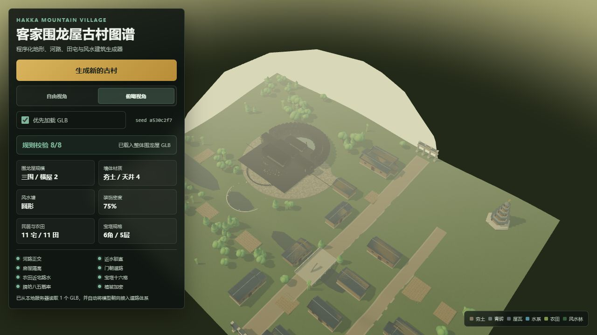

# hakka-village-3d

一个可交互、可随机生成的客家围龙屋古村 3D 地图项目。项目由单文件 Three.js 网页、3ds Max 辅助建模脚本和本地 FBX 转 GLB 工具组成，目标是让传统客家建筑的空间逻辑、围龙层次和山水关系可以在浏览器中直观浏览。



## 项目亮点

- 单 HTML 入口：`hakka-village-generator.html` 内置 CSS、JavaScript、场景生成和 UI，不需要前端构建工具。
- 优先加载 `models/hakka-village.glb`，加载失败时自动回退到程序化围龙屋，不白屏、不中断地图生成。
- 围龙屋结构包含三堂两横、化胎、前低后高、同心围龙、风水塘和风水林。
- 支持一围、二围、三围随机规模，以及夯土/青砖、地形起伏、装饰密度、风水塘形状等随机变量。
- 道路与河道严格正交，近水道路保持笔直，民居门朝道路，房屋之间保留隔离区域。
- 农田、树木和重复建筑采用批量化或低成本策略，兼顾画面密度与浏览器性能。
- 使用 `MeshStandardMaterial`、Canvas 动态纹理、阴影、雾效和可选 Bloom 后处理。
- 支持 `OrbitControls` 阻尼旋转、缩放限制、俯仰限制、WASD/方向键平移。
- 提供“自由视角”和“俯瞰视角”切换，适合快速查看村落格局和观察建筑细节。

## 技术栈

- Three.js CDN 版本，含 `OrbitControls`、`GLTFLoader`、`EffectComposer` 和 `UnrealBloomPass`
- HTML5 Canvas、CSS、原生 JavaScript
- Python 3.10+
- `trimesh`、`numpy`、`Pillow`，高面数模型减面时使用 `fast-simplification`
- Autodesk 3ds Max 2022
- VS Code Live Server

## 目录结构

```text
outputs/
├─ hakka-village-generator.html       # 单文件网页入口
├─ hakka-village.fbx                  # 3ds Max 导出的源模型
├─ convert_hakka_fbx_to_glb.py        # FBX -> OBJ -> 减面 -> GLB 转换工具
├─ hakka-weilongwu-builder.ms         # 3ds Max 围龙屋基础建模脚本
├─ models/
│  └─ hakka-village.glb               # 网页优先加载的目标模型
├─ hakka-village-glb-preview.png      # GLB 模型预览图
├─ hakka-village-preview.png          # 程序化地图预览图
├─ README.md
├─ .gitignore
└─ LICENSE
```

## 本地运行网页

不要直接双击 HTML。浏览器的 `file://` 协议通常会阻止读取外部 GLB 文件；网页可以安全回退到程序化模型，但要展示高精度 GLB，请使用本地 HTTP 服务。

### 方法一：VS Code Live Server

1. 在 VS Code 中打开 `outputs` 文件夹。
2. 安装扩展 `Live Server`。
3. 右键 `hakka-village-generator.html`。
4. 选择 `Open with Live Server`。
5. 浏览器通常访问 `http://127.0.0.1:5500/hakka-village-generator.html`。

### 方法二：Python 本地服务器

```powershell
cd C:\Users\35131\Documents\Codex\2026-10-07\web-3d-three-js-3ds-max\outputs
python -m http.server 8765
```

然后打开：

```text
http://127.0.0.1:8765/hakka-village-generator.html
```

## 网页操作

- 鼠标左键拖动：旋转视角。
- 鼠标右键拖动：平移视角。
- 滚轮：缩放视角。
- `W` / `A` / `S` / `D` 或方向键：微调镜头位置。
- `自由视角`：适合围绕建筑观察。
- `俯瞰视角`：适合查看道路、水系、农田和围龙屋轴线。
- `生成新的古村`：随机生成一张新地图。
- `使用本地 GLB`：切换是否优先使用外部模型。

如果页面提示“当前为纯代码预览模式”，说明 GLB 未加载或加载失败。网页仍会保留完整的程序化围龙屋和村落生成能力。

## 3ds Max 2022 完整工作流

### 第一步：生成或修改围龙屋模型

1. 打开 3ds Max 2022。
2. 菜单选择 `Scripting > New Script`，打开脚本编辑器。
3. 打开并运行 `hakka-weilongwu-builder.ms`，或在已有工程中继续手动调整围龙屋。
4. 确认三堂两横、化胎、围龙、风水塘和屋顶硬山结构都符合需要。
5. 在导出 FBX 之前，先执行 `File > Save As`，把 `.max` 工程源文件备份到项目目录以外的位置。

### 第二步：从 3ds Max 导出 FBX

1. 选择 `File > Export > Export`。
2. 文件类型选择 `Autodesk (*.FBX)`。
3. 输出到：

```text
C:\Users\35131\Documents\Codex\2026-10-07\web-3d-three-js-3ds-max\outputs\hakka-village.fbx
```

4. 在 FBX 导出设置中勾选几何体、材质、贴图和动画中需要的选项。
5. 游戏模型建议使用米制单位，并尽量在导出前统一对象变换。
6. 如果模型方向在网页中不正确，可修改 HTML 中 `ASSET_MANIFEST.village.forwardOffset`，通常可用 `0`、`Math.PI / 2` 或 `Math.PI` 修正。

3ds Max 2022 是否带 glTF 导出器取决于安装的插件版本。本项目不强制依赖 glTF 插件，下面的 Python 工具可以通过 3ds Max 自带的 OBJ 导出器完成转换。

### 第三步：安装 Python 转换依赖

```powershell
cd C:\Users\35131\Documents\Codex\2026-10-07\web-3d-three-js-3ds-max\outputs
python -m pip install trimesh fast-simplification numpy pillow
```

如果不安装 `fast-simplification`，模型低于目标面数时仍可运行；只有需要自动减面时才会依赖它。

### 第四步：FBX 自动减面并转换为 GLB

推荐直接运行：

```powershell
python .\convert_hakka_fbx_to_glb.py
```

等价的显式参数写法：

```powershell
python .\convert_hakka_fbx_to_glb.py `
  --input hakka-village.fbx `
  --output models/hakka-village.glb `
  --target-faces 35000 `
  --hard-max-faces 50000
```

转换流程如下：

1. Python 查找本机 `3dsmaxbatch.exe`。
2. 3ds Max 批处理模式导入 FBX，并导出为临时 OBJ。
3. `trimesh` 统计网格数量和三角面数量。
4. 超过预算时使用二次误差减面，将模型压到目标面数以内。
5. 将最终模型导出为 `models/hakka-village.glb`。

默认目标是 35,000 面，硬上限是 50,000 面。当前项目中的 `hakka-village.glb` 为 7 个网格、12,191 个三角面、约 0.41 MB，不需要继续减面。

如果脚本找不到 3ds Max，可以显式指定批处理程序路径：

```powershell
$env:THREEDSMAX_BATCH = 'D:\application\tools\3dsmax\3ds Max 2022\3dsmaxbatch.exe'
python .\convert_hakka_fbx_to_glb.py
```

如果已经有中间 OBJ，可以跳过 3ds Max 再导出一次：

```powershell
python .\convert_hakka_fbx_to_glb.py --reuse-obj
```

### 第五步：网页加载新模型

转换完成后，确保文件路径为：

```text
outputs/models/hakka-village.glb
```

HTML 中的默认配置已经指向这个文件：

```js
village: { path: "./models/hakka-village.glb", forwardOffset: 0 }
```

重新启动 Live Server 或刷新页面即可。模型存在时会优先加载 GLB；模型缺失、损坏或请求超时时会自动切换为程序化模型。

## GitHub 上传命令

在 `outputs` 目录执行：

```powershell
git init
git branch -M main
git add .
git status
git commit -m "Initial commit: Hakka village 3D generator"
git remote add origin https://github.com/<你的用户名>/hakka-village-3d.git
git remote -v
git push -u origin main
```

如果 `origin` 已经存在，将 `git remote add` 替换为：

```powershell
git remote set-url origin https://github.com/<你的用户名>/hakka-village-3d.git
```

当前 GLB 约 0.41 MB，常规 Git 提交即可，不需要 Git LFS。

## 清理本地文件

`outputs` 的上一级目录提供 `一键清理本地文件.bat`。它会删除 `outputs` 整个目录，包括网页、FBX、GLB、Git 仓库和所有中间文件。

> 警告：运行清理脚本之前，务必把 3ds Max 的 `.max` 工程源文件拷贝到电脑的其他地方备份。清理脚本删除后不会进入回收站，也不留任何恢复痕迹。

只有在确认 GitHub 仓库已经成功推送并检查完远程文件后，才运行清理脚本。

## 许可证

本项目使用 MIT License，详见 `LICENSE`。
